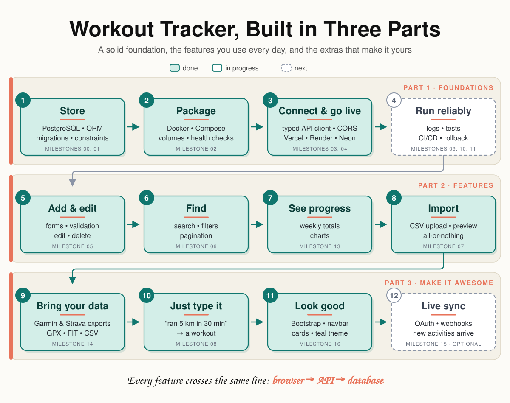
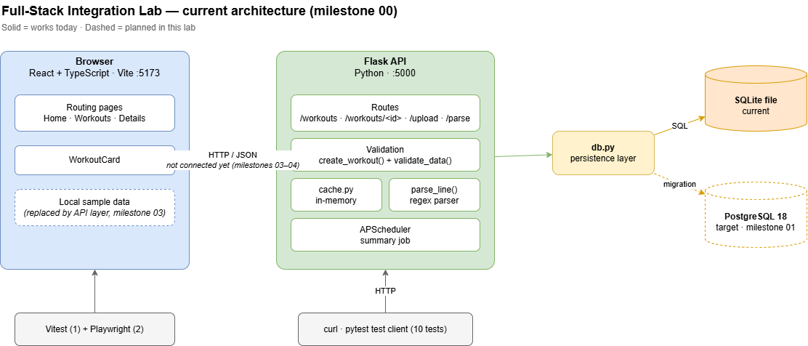

# Workout Tracker

**Log, find and analyse your workouts, typed in by hand, imported from Garmin or Strava exports, or written as a sentence.**
A React + TypeScript frontend and a Flask API on PostgreSQL, built in three parts and deployed.

**[▶ Live demo](https://workout-tracker-ajita.vercel.app)** · [API](https://workouts-tracker-7b09.onrender.com/workouts) · [Docs](docs/)

> ⏱ The API runs on Render's free tier and sleeps after 15 minutes of inactivity. On the first visit you may see "Server is taking too long to respond." Wait about 30 seconds and click **Try again**.

<!-- Screenshot or GIF of the app goes here -->

---

## The map



| Part | What it covers | Stages |
|---|---|---|
| **1. Foundations** | The base everything stands on: database, containers, the browser–API boundary, deployment, reliability | 1–4 · milestones 00–04, 09–11 |
| **2. Features** | What you use every day: add, edit, delete, find, see progress, import | 5–8 · milestones 05–07, 13 |
| **3. Make it awesome** | What makes it yours: bring your Garmin/Strava data, type a sentence, a polished look, live sync | 9–12 · milestones 08, 14, 16, 15 |

Every feature crosses the same line: **browser → API → database**.

**Status:** stages 1–3 and 5–11 are done. Stage 4 (*Run reliably*: logs, end-to-end tests, CI/CD) is in progress; stage 12 (*Live sync*) is optional.

---

| You want… | Read this | Time |
|---|---|---|
| **The overview** | The map, [What this project shows](#what-this-project-shows), the live demo | 2 min |
| **The details** | The three parts below, then the linked milestone docs | 15 min+ |
| **To run it** | [Run it locally](#run-it-locally) | 5 min |

---

## What this project shows

- **Two separate apps joined into one system:** an existing Flask API and React frontend, connected through a typed API layer and a shared contract.
- **Real persistence:** PostgreSQL with an ORM, versioned migrations and named constraints.
- **Reproducible setup:** the whole stack starts with one Docker Compose command.
- **Deployed on three services:** Vercel (frontend), Render (API), Neon (PostgreSQL).
- **Debugged in production:** a stale-connection bug found by tracing one request through all three services, and fixed (see [stage 3](#3-connect--go-live)).
- **Validation on both sides:** instant feedback in the browser, with the server as the authority.
- **Untrusted input handled in one pipeline:** CSV, GPX and FIT files and typed text all become the same rows, with one preview, one validation and one duplicate check.
- **Tested at every layer:** pytest against a real test database, Vitest, a contract of real API responses checked by both sides, Playwright end to end.

**Stack:** React · TypeScript · Vite · Bootstrap · Flask · SQLAlchemy 2.0 · Alembic · PostgreSQL · Docker · Vercel · Render · Neon · pytest · Vitest · Playwright

---

# Part 1 · Foundations

*The base everything else stands on.*

### 1. Store
**Why it matters:** data has to survive restarts, and invalid data must never get in.
**Key question:** *Where do you validate: in the API, or in the database?* (Both, for different reasons.)

- Baseline tests for an API that had none; user journeys and an API contract before changing anything
- PostgreSQL via the SQLAlchemy 2.0 ORM; versioned schema with Alembic and five named CHECK constraints
- Multi-row writes in one transaction; separate test database; repeatable seed script

📄 [00-baseline](docs/00-baseline.md) · [01-postgresql](docs/01-postgresql.md) · [api-contract](docs/api-contract.md)

### 2. Package
**Why it matters:** "works on my machine" isn't a setup.
**Key question:** *Why can't the API reach the database at `localhost` inside Docker?*

- Dockerfile for the API, Compose for database, API and frontend
- Health check, so the API waits until PostgreSQL is ready
- Named volume: data survives container replacement

📄 [02-docker](docs/02-docker.md)

### 3. Connect & go live
**Why it matters:** the browser–API boundary is where most integration bugs live, and a deployed app meets problems a local one never shows.
**Key question:** *What happens when a serverless database closes idle connections?*

- Typed API client with a timeout, cancellation and separate error classes (`NetworkError`, `ApiError`, `InvalidResponseError`)
- Runtime validation of every response; one error format (`{"errors": [...]}`); CORS per origin
- Deployed to Vercel, Render and Neon with config per environment
- Traced one request through all three services and found a **production bug**: Neon closes idle connections after about 5 minutes, and the connection pool handed out a dead one (500). Fixed with `pool_pre_ping`.

📄 [03-browser-api-boundary](docs/03-browser-api-boundary.md) · [04-first-vertical-slice](docs/04-first-vertical-slice.md)

### 4. Run reliably *(in progress: milestones 09 and 10 done, 11 next)*
**Why it matters:** in production, nobody sees the screen when something goes wrong. The logs have to point to the one request that failed.
**Key question:** *A user reports an error. How do you find their request in the logs?* By the reference they see: every response carries an `X-Request-ID`, every log line contains it, and every error message shows it.

- Structured JSON logs with request IDs; `500` for bugs (with a stack trace in the log), `503` for an unavailable database (with a one-line cause)
- `/health` and `/ready`, and a connection badge with three states
- Failure drills (database down, a planted bug, a slow API) and a real incident written up: deploys that had silently stopped
- Tests of the integrated system: honest coverage reports (backend 91%), tests for the API client, a **contract** of real API responses in `contracts/` that the frontend's parsers check, and 5 Playwright journeys against the running stack
- _Next: CI/CD and rollback (11)_

📄 [09-diagnose-failures](docs/09-diagnose-failures.md) · [10-test-the-system](docs/10-test-the-system.md)

---

# Part 2 · Features

*What you use every day.*

### 5. Add & edit
**Why it matters:** user input is the one thing the app doesn't control.
**Key question:** *The workout was saved, but the response got lost. What does the user see?* An honest "We couldn't confirm the save, check your workouts", never a false "failed".

- `POST`, `PUT` and `DELETE` endpoints with **one shared validation**, and the same rules mirrored in the browser; the **server stays the authority**
- Accessible form for adding and editing: labels, `aria-invalid`, `aria-describedby`, server errors mapped back to the right field (`distance_km` → Distance)
- Saving state, no double submits, success feedback, input kept on failure
- Delete with an inline confirmation; a `404` on delete counts as "already gone"
- 23 backend and 14 frontend tests, including component tests with a faked API

📄 [05-forms-validation](docs/05-forms-validation.md)

### 6. Find
**Why it matters:** a list of 40 rows works without any of this. A list of 4,000 needs filters, a page size the server controls, and an order that doesn't change between pages.
**Key question:** *Two searches are in flight, and the older one answers last. Which result does the user see?* The newest one: the previous request is cancelled, and every request, including a retry, goes through one path.
 
- Validated filters and sorting, with `id` as tie-breaker for a stable order across pages
- Filter, sort and page state in the URL: bookmarkable, and back/forward work
- Distinct empty states: no workouts yet, no matches for this filter, page out of range
- Two indexes for the sorted, filtered list, measured with `EXPLAIN ANALYZE` at 100,000 rows (6.3 ms → 0.08 ms)

📄 [06-search-pagination](docs/06-search-pagination.md)

### 7. See progress
**Why it matters:** a list answers "what did I do?". Stats answer "am I doing more or less than last month?", and that needs totals, not rows.
**Key question:** *Who should add up 500 workouts: the browser, the API, or the database?* The database: it returns a few dozen totals; the browser only reshapes them for the chart.

- `GET /stats/weekly`: totals per week and sport, computed in SQL with `GROUP BY`
- Stacked bar charts of distance and time per week (Recharts), with loading, error and empty states
- The API's rows pivoted into chart rows by one pure, tested function

📄 [13-stats](docs/13-stats.md)

### 8. Import
**Why it matters:** imported files are the least trustworthy input an app gets: other programs, other encodings, other people's spreadsheets, all arriving as one batch.
**Key question:** *One row in a 500-row CSV is invalid. What happens to the other 499?* Nothing is saved. The preview shows the bad row first, and the import saves all rows in one transaction or none.

- File checks: size, type, encoding (including Excel's invisible BOM), header, row limit
- A preview of every row with its errors before anything is saved
- Optional dates per row; rows that already exist are skipped and reported

📄 [07-csv-import](docs/07-csv-import.md)

---

# Part 3 · Make it awesome

*What makes it yours.*

### 9. Bring your data
**Why it matters:** most workouts are already recorded by a watch or an app. Reading the files they export means nothing has to be typed in twice.
**Key question:** *How do you add a new import format without touching the code that already works?* One converter per format turns the file into the same rows a CSV produces; validation, preview and the duplicate check are shared.

- GPX tracks from Garmin or Strava: distance and duration computed from the GPS points
- FIT files from Garmin watches, one workout per session
- Strava's `activities.csv` export, recognised by its header

📄 [14-activity-files](docs/14-activity-files.md)

### 10. Just type it
**Why it matters:** "ran 5 km in 30 min" is how people already note a workout. A form with four fields is slower than typing one line.
**Key question:** *How do you accept free text without accepting anything at all?* Parse leniently, validate strictly, and show the result before saving.

- One workout per line, understood by a small parser ("swam 1.5 km 40 min", "badminton 90 min")
- The same preview, validation and duplicate check as file imports, because typed text is just another input format
- A Quick add page: Check shows the preview, Save stores the new workouts

📄 [08-just-type-it](docs/08-just-type-it.md)

### 11. Look good
**Why it matters:** the interface is the first thing anyone sees, and a tool that looks unfinished doesn't get used.
**Key question:** *How do you restyle a whole app without touching how it works?* Change only the markup: Bootstrap classes on the existing JSX, with state, requests and validation left as they are.

- A teal theme (the colour of the map) on Bootstrap 5, with a navbar that collapses on phones
- A home page with this week's totals and the three ways to add workouts
- One colour and icon per sport, shared by the list, the details page and the charts
- Accessible forms kept intact: the component tests caught units that had moved out of the labels

📄 [16-look-good](docs/16-look-good.md)

### 12. Live sync 🔜 _(milestone 15, optional)_
**Why it matters:** _new activities appear without exporting anything_

- _OAuth login, token refresh, webhooks for new activities_

---

## Architecture

<!-- Architecture diagram (docs/architecture.drawio exported as SVG) -->

<!-- Request sequence: browser → Vercel → Cloudflare/Render → Neon -->

| Layer | Local | Production |
|---|---|---|
| Frontend | Vite dev server, port 5173 | Vercel |
| API | Flask in Docker, port 5000 | Render (Docker) |
| Database | PostgreSQL 18 in Docker, port 5433 | Neon (PostgreSQL) |

---

## Run it locally

Requirements: Docker Desktop and Git.

```bash
git clone https://github.com/ajitagupta/fullstack-integration-lab.git
cd fullstack-integration-lab
cp .env.example .env        # then set POSTGRES_PASSWORD
docker compose up --build
```

Open http://localhost:5173. More commands (migrations, seed data, tests, reset) are in [docs/02-docker.md](docs/02-docker.md).

---

## Key decisions

| Decision | Why | Details |
|---|---|---|
| SQLAlchemy ORM instead of raw SQL | Typed models, one place for the schema, migrations generated from it | [01](docs/01-postgresql.md) |
| `201 Created` + one error format | Clients rely on one shape for every error | [api-contract](docs/api-contract.md) |
| Runtime validation of API responses | TypeScript types disappear at runtime; the server can still send anything | [03](docs/03-browser-api-boundary.md) |
| `pool_pre_ping` for Neon | Serverless databases close idle connections | [04](docs/04-first-vertical-slice.md) |
| Cold start accepted, not engineered around | A free-tier hosting limit, documented instead of hidden | [04](docs/04-first-vertical-slice.md) |
| Client errors in the API's shape | Server errors land in the same place on the form | [05](docs/05-forms-validation.md) |
| Cancel outdated requests | An older answer must never overwrite a newer one | [06](docs/06-search-pagination.md) |
| Indexes chosen from measurements | Measured with `EXPLAIN ANALYZE` at 100,000 rows before adding any | [06](docs/06-search-pagination.md) |
| Totals computed in SQL | The database returns a few dozen sums instead of every row | [13](docs/13-stats.md) |
| Preview before every import, all or nothing | One bad row must not leave half a file saved | [07](docs/07-csv-import.md) |
| One converter per input format | A new format is one function; the shared pipeline stays untouched | [14](docs/14-activity-files.md) |
| Bootstrap classes, no component library | Restyling changed only markup; logic and tests stayed as they were | [16](docs/16-look-good.md) |
| _more as the parts are built_ | | |

---

## What I'd do next

_(at the end)_

---

## About

Built by **Ajita Gupta**, full-stack software engineer in Zurich.
This project is the sequel to my Python lab and my frontend engineering lab, and connects both into one system.