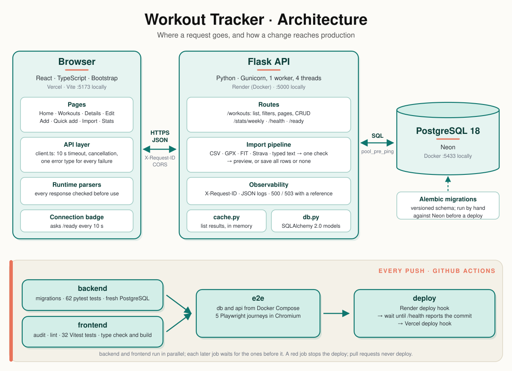

# Workout Tracker

A workout tracker with a React + TypeScript frontend and a Flask API on PostgreSQL. Workouts can be added with a form, typed as a sentence ("ran 5 km in 30 min") or imported from CSV, GPX and FIT files.

This is a learning project. It connects the backend from my Python lab and the frontend from my frontend lab into one app, and takes it to deployment.

**[Live demo](https://workout-tracker-ajita.vercel.app)** · [API](https://workouts-tracker-7b09.onrender.com/workouts) · [Docs](docs/)

> The API runs on Render's free tier and sleeps after 15 minutes. On the first visit you may see "Server is taking too long to respond." Wait about 30 seconds and click **Try again**.

---

## The map


Stages 1-11 are done. Stage 12 (live sync with Strava) is not built.

## Features

- Add, edit and delete workouts, with validation in the form and on the server
- A list with a sport filter, sorting and pages; the filters are kept in the URL
- Import from CSV, GPX and FIT files and Strava's export, with a preview before saving
- Quick add: type workouts as text, one per line
- Weekly charts of distance and time per sport
- A connection badge that shows when the API or the database is down

**Stack:** React · TypeScript · Vite · Bootstrap · Flask · SQLAlchemy · Alembic · PostgreSQL · Docker · Gunicorn · pytest · Vitest · Playwright · GitHub Actions · Vercel · Render · Neon

---

## How it was built

Each milestone has a short doc with what was built, the decisions and what went wrong.

| Stage | What | Docs |
|---|---|---|
| 1. Store | PostgreSQL, SQLAlchemy, Alembic migrations, database constraints | [00](docs/00-baseline.md) · [01](docs/01-postgresql.md) |
| 2. Package | Docker Compose for frontend, API and database | [02](docs/02-docker.md) |
| 3. Connect & go live | A typed API layer in the frontend, one error format, deployment | [03](docs/03-browser-api-boundary.md) · [04](docs/04-first-vertical-slice.md) |
| 4. Run reliably | Logs with request IDs, health checks, tests across the system, CI/CD | [09](docs/09-diagnose-failures.md) · [10](docs/10-test-the-system.md) · [11](docs/11-ci-cd.md) |
| 5. Add & edit | Forms with validation on both sides | [05](docs/05-forms-validation.md) |
| 6. Find | Filters, sorting, pages, indexes | [06](docs/06-search-pagination.md) |
| 7. See progress | Weekly totals in SQL, charts | [13](docs/13-stats.md) |
| 8. Import | CSV upload with preview, all or nothing | [07](docs/07-csv-import.md) |
| 9. Bring your data | GPX, FIT and Strava files | [14](docs/14-activity-files.md) |
| 10. Just type it | Workouts from typed text | [08](docs/08-just-type-it.md) |
| 11. Look good | Bootstrap and a teal theme | [16](docs/16-look-good.md) |

The API rules (status codes, error format) are in [api-contract](docs/api-contract.md).

---

## Architecture



| Part | Local | Production |
|---|---|---|
| Frontend | Vite, port 5173 | Vercel |
| API | Flask with Gunicorn in Docker, port 5000 | Render (the same Docker image) |
| Database | PostgreSQL 18 in Docker, port 5433 | Neon |

---

## Run it locally

Requirements: Docker Desktop and Git.

```bash
git clone https://github.com/ajitagupta/fullstack-integration-lab.git
cd fullstack-integration-lab
cp .env.example .env        # then set POSTGRES_PASSWORD
docker compose up -d --build
docker compose exec api alembic upgrade head    # create the tables
docker compose exec api python seed.py          # optional: 40 sample workouts
```

Open http://localhost:5173. More commands are in [docs/02-docker.md](docs/02-docker.md). Tests: see the [backend](backend/README.md#tests) and [frontend](frontend/README.md#scripts) READMEs.

---

## Some decisions

| Decision | Why |
|---|---|
| One error format for every endpoint | The frontend can show each message next to the right field |
| Check API responses at runtime | TypeScript types don't exist at runtime |
| `pool_pre_ping` | Neon closes idle connections; without it, the first request after a pause failed |
| Preview before every import, save all rows or none | One bad row must not leave half a file saved |
| One converter per file format | A new format is one function; validation stays shared |
| Totals computed in SQL | The database returns a few sums instead of every row |
| Gunicorn with one worker | The list cache lives in memory and would get out of sync with several workers |
| Deploy from CI, backend first | Nothing untested is deployed, and the frontend never talks to an older API |

---

## What I'd do next

- Let the user choose the date in the form and in Quick add (both save today's date for now).
- Run migrations in the pipeline instead of by hand.
- Turn on Dependabot alerts for the Python and npm packages.
- Try a data-fetching library such as TanStack Query instead of loading data in effects.
- Live sync with Strava (OAuth and webhooks).

---

## About

Built by **Ajita Gupta**, full-stack software engineer in Zurich.