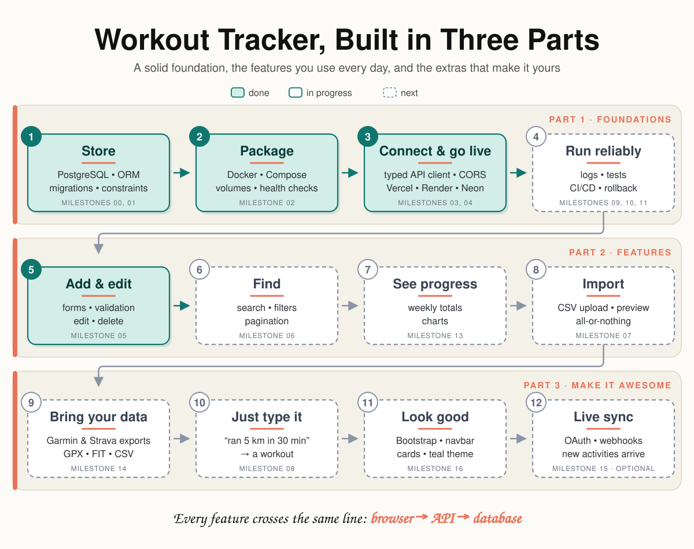
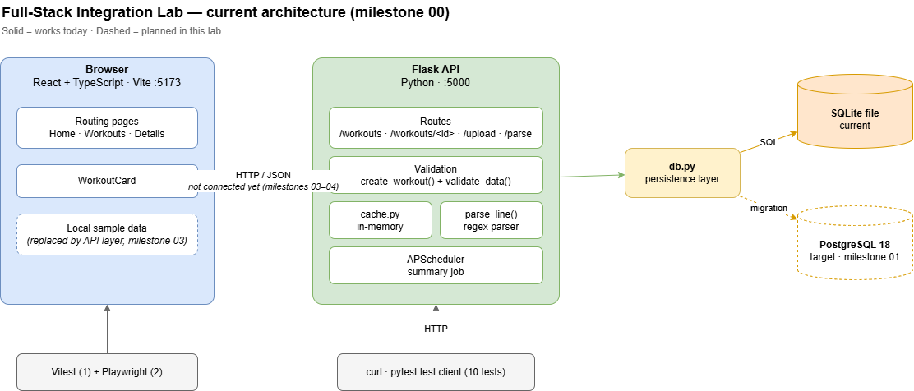

# Workout Tracker

**Log, find and analyse your workouts, typed in by hand, imported from Garmin or Strava exports, or written as a sentence.**
A React + TypeScript frontend and a Flask API on PostgreSQL, built in three parts and deployed.

**[▶ Live demo](https://workout-tracker-ajita.vercel.app)** · [API](https://workouts-tracker-7b09.onrender.com/workouts) · [Docs](docs/)

> ⏱ The API runs on Render's free tier and sleeps after 15 minutes of inactivity. On the first visit you may see "Server is taking too long to respond." Wait about 30 seconds and click **Try again**.

<!-- Screenshot or GIF of the app goes here -->

---

## The map



| Part | What it covers | Stages |
|---|---|---|
| **1. Foundations** | The base everything stands on: database, containers, the browser–API boundary, deployment, reliability | 1–4 · milestones 00–04, 09–11 |
| **2. Features** | What you use every day: add, edit, find, see progress, import | 5–8 · milestones 05–07, 13 |
| **3. Make it awesome** | What makes it yours: bring your Garmin/Strava data, type a sentence, live sync | 9–11 · milestones 08, 14, 15 |

Every feature crosses the same line: **browser → API → database**.

---

## How to read this

| You want… | Read this | Time |
|---|---|---|
| **The overview** | The map, [What this project shows](#what-this-project-shows), the live demo | 2 min |
| **The details** | The three parts below, then the linked milestone docs | 15 min+ |
| **To run it** | [Run it locally](#run-it-locally) | 5 min |

---

## What this project shows

- **Two separate apps joined into one system:** an existing Flask API and React frontend, connected through a typed API layer and a shared contract.
- **Real persistence:** PostgreSQL with an ORM, versioned migrations and named constraints.
- **Reproducible setup:** the whole stack starts with one Docker Compose command.
- **Deployed on three services:** Vercel (frontend), Render (API), Neon (PostgreSQL).
- **Debugged in production:** a stale-connection bug found by tracing one request through all three services, and fixed (see [stage 3](#3-connect--go-live)).
- **Validation on both sides:** instant feedback in the browser, with the server as the authority.
- **Tested at every layer:** pytest against a real test database, Vitest, Playwright end to end.

**Stack:** React · TypeScript · Vite · Flask · SQLAlchemy 2.0 · Alembic · PostgreSQL · Docker · Vercel · Render · Neon · pytest · Vitest · Playwright

---

# Part 1 · Foundations

*The base everything else stands on.*

### 1. Store
**Why it matters:** data has to survive restarts, and invalid data must never get in.
**Key question:** *Where do you validate: in the API, or in the database?* (Both, for different reasons.)

- Baseline tests for an API that had none; user journeys and an API contract before changing anything
- PostgreSQL via the SQLAlchemy 2.0 ORM; versioned schema with Alembic and five named CHECK constraints
- Multi-row writes in one transaction; separate test database; repeatable seed script

📄 [00-baseline](docs/00-baseline.md) · [01-postgresql](docs/01-postgresql.md) · [api-contract](docs/api-contract.md)

### 2. Package
**Why it matters:** "works on my machine" isn't a setup.
**Key question:** *Why can't the API reach the database at `localhost` inside Docker?*

- Dockerfile for the API, Compose for database, API and frontend
- Health check, so the API waits until PostgreSQL is ready
- Named volume: data survives container replacement

📄 [02-docker](docs/02-docker.md)

### 3. Connect & go live
**Why it matters:** the browser–API boundary is where most integration bugs live, and a deployed app meets problems a local one never shows.
**Key question:** *What happens when a serverless database closes idle connections?*

- Typed API client with a timeout, cancellation and separate error classes (`NetworkError`, `ApiError`, `InvalidResponseError`)
- Runtime validation of every response; one error format (`{"errors": [...]}`); CORS per origin
- Deployed to Vercel, Render and Neon with config per environment
- Traced one request through all three services and found a **production bug**: Neon closes idle connections after about 5 minutes, and the connection pool handed out a dead one (500). Fixed with `pool_pre_ping`.

📄 [03-browser-api-boundary](docs/03-browser-api-boundary.md) · [04-first-vertical-slice](docs/04-first-vertical-slice.md)

### 4. Run reliably 🔜
**Why it matters:** _(milestones 09, 10, 11)_
**Key question:** _e.g. A user reports an error. How do you find their request in the logs?_

- _Structured logs, request IDs, health and readiness checks_
- _Tests at every layer, run in CI on every push_
- _Production server (gunicorn), deployment checks, rollback and backup/restore_

---

# Part 2 · Features

*What you use every day.*

### 5. Add & edit 🚧
**Why it matters:** user input is the one thing the app doesn't control.
**Key question:** *The workout was saved, but the response got lost. What does the user see?*

- Accessible form: labels, `aria-invalid`, `aria-describedby`, errors after the first submit
- Client validation mirrors the server's rules; the **server stays the authority**
- Server errors mapped back to the right field (`distance_km` → Distance)
- _Submit states, no double submits, success feedback · edit & delete_

📄 [05-forms-validation](docs/05-forms-validation.md)

### 6. Find 🔜
**Why it matters:** _(milestone 06)_
**Key question:** _e.g. Two searches are in flight, and the older one answers last. Which result does the user see?_

- _Search and filters, with the state in the URL (back/forward works)_
- _Pagination with a stable sort_

### 7. See progress 🔜
**Why it matters:** _(milestone 13)_

- _Weekly totals per sport, computed in SQL_
- _Charts_

### 8. Import 🔜
**Why it matters:** _(milestone 07)_
**Key question:** _e.g. One row in a 500-row CSV is invalid. What happens to the other 499?_

- _File upload with preview and row-level errors_
- _All-or-nothing import in one transaction_

---

# Part 3 · Make it awesome

*What makes it yours.*

### 9. Bring your data 🔜 _(milestone 14)_
**Why it matters:** nobody starts from zero. Years of workouts already live in Garmin and Strava.

- _Import Garmin and Strava export files (GPX, FIT, CSV), with no API keys needed_

### 10. Just type it 🔜
**Why it matters:** _(milestone 08)_

- _"ran 5 km in 30 min" → a workout, checked by the same validation as the form_

### 11. Live sync 🔜 _(milestone 15, optional)_
**Why it matters:** _new activities appear without exporting anything_

- _OAuth login, token refresh, webhooks for new activities_

---

## Architecture

<!-- Architecture diagram (docs/architecture.drawio exported as SVG) -->

<!-- Request sequence: browser → Vercel → Cloudflare/Render → Neon -->

| Layer | Local | Production |
|---|---|---|
| Frontend | Vite dev server, port 5173 | Vercel |
| API | Flask in Docker, port 5000 | Render (Docker) |
| Database | PostgreSQL 18 in Docker, port 5433 | Neon (PostgreSQL) |

---

## Run it locally

Requirements: Docker Desktop and Git.

```bash
git clone https://github.com/ajitagupta/fullstack-integration-lab.git
cd fullstack-integration-lab
cp .env.example .env        # then set POSTGRES_PASSWORD
docker compose up --build
```

Open http://localhost:5173. More commands (migrations, seed data, tests, reset) are in [docs/02-docker.md](docs/02-docker.md).

---

## Key decisions

| Decision | Why | Details |
|---|---|---|
| SQLAlchemy ORM instead of raw SQL | Typed models, one place for the schema, migrations generated from it | [01](docs/01-postgresql.md) |
| `201 Created` + one error format | Clients rely on one shape for every error | [api-contract](docs/api-contract.md) |
| Runtime validation of API responses | TypeScript types disappear at runtime; the server can still send anything | [03](docs/03-browser-api-boundary.md) |
| `pool_pre_ping` for Neon | Serverless databases close idle connections | [04](docs/04-first-vertical-slice.md) |
| Cold start accepted, not engineered around | A free-tier hosting limit, documented instead of hidden | [04](docs/04-first-vertical-slice.md) |
| Client errors in the API's shape | Server errors land in the same place on the form | [05](docs/05-forms-validation.md) |
| _more as the parts are built_ | | |

---

## What I'd do next

_(at the end)_

---

## About

Built by **Ajita Gupta**, full-stack software engineer in Zurich.
This project is the sequel to my Python lab and my frontend engineering lab, and connects both into one system.