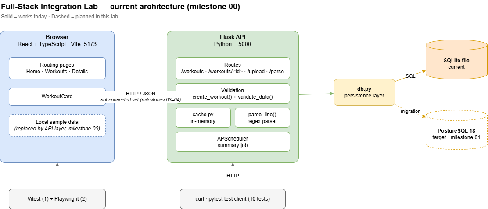

# 00 — Baseline & Architecture

## Decisions
### Why one repository?
Because frontend and backend live in one repository, a change that affects both — for example renaming duration_min — is made in a single commit, so there is only one pull request required and frontend and backend can never be out of step. Tests that span both sides run against the combination of backend and frontend. Releases are tagged combined with v1.0, etc.

### Why reuse the workout domain?
We already have the Flask API, validation rules, parser, tests and React components so the effort goes into the integration. We reuse the workout domain so we can take advantage of our domain knowledge in this field, e.g. in my personal case it is my hobby to do sports and I know about it well. If we know the domain inside out we can easily spot errors in API, database, failure handling and deployment.

### What belongs in the frontend, API and database?
The frontend is mainly for user interaction. We take the rule "a run needs a distance". The user form will show "distance is required" immediately, before anything is sent. That's helpful but doesn't protect: anyone can skip the form and send a curl request directly over the terminal. 

The API is the authority layer. Every request passes through it (user form, curl, CSV upload, file parsing). Here, the rule is enforced - the API rejects the request with a 400 and a clear error message, which the frontend can display.

The database layer is the last and final safety net. Once again we check: "if sport is run, distance must not be empty". Even if there is a code change or bug (e.g. future import path that forgets to validate) the database refuses the row no matter where it comes from. Currently, this is enforced only in the API; database constraint will be added in milestone 01.

In short: frontend = fast feedback, API = the rule, database = guarantee.

## User journeys
### 1. Browse and find workouts
As a user, I want to filter and search my workouts and page through them, so that I can quickly find a specific session.
- [ ] Choosing a sport shows only workouts of that sport.
- [ ] Results come in pages; I can go to the next/previous page and see the total count.
- [ ] Changing a filter takes me back to page 1.
- [ ] If nothing matches, I see "No workouts match your filters", which is different from "No workouts yet".
- [ ] Copying the URL and opening it again shows the same filters and page.

### 2. Adding workouts
As a user I want to add a workout through a validated form, so that I can quickly add my workouts.
- [ ] There is an "Add Workout" form.
- [ ] Pressing "Save" is the confirmation before a workout is added.
- [ ] I must see a red-highlighted field when a field is wrong and a message next to the field, such as "Distance is required for a run".
- [ ] After adding, the workout appears in the list.
- [ ] If saving fails, the user sees an error and everything they typed stays in the form.
- [ ] Clicking Save twice quickly doesn’t create two workouts.
- [ ] After a successful save, the user sees a confirmation, for example "Workout saved".

### 3. CSV import
As a user I want to import a CSV file with a preview and clear error feedback, so that I can add my workouts in bulk.
- [ ] There is an "Import CSV" option where I can choose a file.
- [ ] I must confirm before a CSV file is imported.
- [ ] A preview should show all the file content in formatted form before anything is saved.
- [ ] A bad row shows its row number and the reason in the preview.
- [ ] If any one row is bad, nothing is saved, and I can see which rows to fix.
- [ ] The "Confirm" button is disabled while any row has an error.
- [ ] After importing, all workouts in the file appear formatted in the list.
- [ ] A file that's too large, or isn't a CSV, gives a clear message instead of a crash.
- [ ] After importing, I see a summary, for example "12 workouts imported".

### 4. Parsing
As a user I want to preview and confirm natural-language entries, so that workouts can be types in short sentences, like quick notes.
- [ ] There is a text box where I can type one workout per line.
- [ ] A line not understood by the parser is shown with an error, for example "Line 2: distance missing".
- [ ] The Preview shows how each line was interpreted (sport, distance, duration), so I can check it.
- [ ] After confirming with a "Save" button, the natural-language workouts appear in the list. Nothing is saved before that.

### 5. States
As a user I want to understand loading, empty, success and failure states, so that I know if an action worked or not.
- [ ] I must see each state with a message and distinct color.
- [ ] While workouts are loading, I see 'Loading workouts...'.
- [ ] When there are no workouts in the list, I see "No workouts yet - add your first one".
- [ ] When the API is down, I see a "Can't reach the server" message and a 'Try again' button that reloads the list, so that I can try again.
- [ ] After an action succeeds, e.g. saving or importing, I must see a success message.

## Reused, adapted, new
| Part | Source | Status | Notes |
|---|---|---|---|
| `app.py` (Flask API) | Python lab, concept 10 | Adapted | Status codes, error format and parse endpoint change in milestones 03, 05, 08 |
| `db.py` (persistence) | Python lab, concept 10 | Adapted | Rewritten for PostgreSQL in milestone 01 |
| `cache.py` (cache) | Python lab, concept 10 (introduced in concept 9) | Reused | in-memory, one process only; revisit if the app runs several processes |
| Caching tests (cache) | Python lab, concept 9 | Reused | Copied from concept 09; concept 10 had no tests |
| `parse_line()` (parser) | Python lab, concept 10 | Reused | Logic unchanged; the endpoint around it is split into preview/save in milestone 08 |
| `test_baseline.py` (testing) | Fullstack Integration lab, milestone 00 | New | Protects existing behaviour during the PostgreSQL migration |
| Routing app | Frontend lab, concept 12 | Adapted | Gets connected to the API in milestones 03–04 |
| Playwright tests | Frontend lab, concept 12 | Adapted | Currently cover navigation only; extended to full-system journeys in milestone 10 |
| `WorkoutCard` and Vitest setup | Frontend lab, concept 11 | Reused | Reused for list items; Vitest setup kept as is |
| Fetch logic | Frontend lab, concept 07 | New | Concept 07 as reference; rebuilt as the API layer in milestone 03 |
| Form | Frontend lab, concept 06 | New | Concept 06 as reference; rebuilt in milestone 05 as a typed, accessible form with server error mapping |

## Starting behaviour

### API
- `POST /workouts` returns `200`; `POST /workouts/upload` and `POST /workouts/parse` return `201`. Should be `201` everywhere; changed deliberately in milestone 03.
- Two error formats: single errors use `{"error": "..."}`, upload and parse use `{"errors": [...]}`. Unified in milestone 03.
- Validation is duplicated: `create_workout()` has its own checks, while upload and parse share `validate_data()`. Their messages already differ.
- `limit` has no upper bound (`?limit=1000000` works); the default page size is 2.
- Invalid query parameters (e.g. `?limit=abc`, `?min_distance=x`) are not validated: `int()`/`float()` raises an error and the API returns `500` instead of `400`. Applies to `limit`, `offset`, `min_distance`, `min_duration`.
- `/workouts/parse` parses and saves in one step; there is no preview. Split in milestone 08.
- CSV rows with non-numeric values (e.g. `run,abc,30`) crash `clean_row()`: the API returns `500` instead of a row error.
- An empty `POST /workouts/parse` request returns `201` with `{"inserted": 0}` instead of a `400`.

### Data
- SQLite stores durations as floats: `30` comes back as `30.0`.
- Types differ by path: the CSV import gives `duration_min` as a float, the parser as an int.
- The database rule "a run needs a distance" is enforced only in the API, not by the database.

### Tests
- Concept 10 had no tests; the 3 caching tests were copied from concept 09.
- Added 7 baseline tests (`test_baseline.py`): create, validation, filter, pagination, CSV valid/invalid, parser (endpoint + `parse_line()`).
- Tests use the real SQLite file, not a separate test database: test runs added ~200 workouts to the development data. Fixed in milestone 01.

### Frontend
- The frontend lab concepts are not cumulative: concept 12 has the routing app, 06 the form, 07 the fetch logic, 11 the component tests.
- `frontend/` is based on concept 12, plus `WorkoutCard` and the Vitest setup from concept 11.
- 1 Vitest component test and 2 Playwright navigation tests, all passing.
- Frontend and API run side by side (Flask on 5000, Vite on 5173) but are not connected yet; the frontend uses local sample data.

# API contract (current state, milestone 00)

## GET /workouts
List workouts with optional filters and pagination.

**Query parameters**
| Name | Type | Default | Notes |
|---|---|---|---|
| `sport` | string | — | Exact match |
| `min_distance` | number | — | |
| `min_duration` | number | — | |
| `limit` | integer | 2 | No upper bound |
| `offset` | integer | 0 | |

**Response 200**
```json
{ "workouts": [ { "id": 1, "sport": "run", "distance_km": 5.0, "duration_min": 30.0 } ],
  "total": 1, "limit": 2, "offset": 0 }
```
Header `X-Cache: HIT` or `MISS`.

**Errors:** none handled. A non-numeric `limit` causes a `500`.

## POST /workouts
Creates one workout.

**Request body (JSON)**
| Field | Type | Required | Rules |
|---|---|---|---|
| `sport` | string | always | one of: swim, run, badminton, cycle, strength, rest |
| `distance_km` | number | for swim, run, cycle | ≥ 0 |
| `duration_min` | number | for swim, run, badminton, cycle, strength | ≥ 0 |

**Response 200 (should be 201; changed in milestone 03)**
```json
{ "id": 1, "sport": "run", "distance_km": 5.0, "duration_min": 30.0 }
```

**Errors** — all `400` with `{"error": "..."}`
| Case | Message |
|---|---|
| Body missing or not JSON | Invalid request body or empty body. Must be JSON. |
| Sport missing or empty | The key sport is missing or empty. Must be swim, run, badminton, cycle, strength, or rest. |
| Duration of sport is missing | The key duration_min is missing. |
| Distance of sport is missing | The key distance_km is missing. |
| Duration must be a int or float | The key duration_min must be a number. |
| Distance must be a int or float | The key distance_km must be a number. |
| Duration must be a positive number or 0 | The key duration_min must be a positive number or 0. |
| Distance must be a positive number or 0 | The key distance_km must be a positive number or 0. |

## GET /workouts/<id>
Returns a single workout by ID.

**Path parameter**
| Name | Type | Notes |
|---|---|---|
| `id` | integer | Route is `<int:workout_id>` |

**Response 200**
```json
{ "id": 1, "sport": "run", "distance_km": 5.0, "duration_min": 30.0 }
```

**Errors** — all `404`
| Case | Message |
|---|---|
| No workout with this ID | Workout not found. |
| Non-numeric ID (`/workouts/abc`) | Flask's default HTML 404 page, not JSON; unified in milestone 03 |

## POST /workouts/upload
Uploads a CSV file content.

**Request (multipart/form-data)**
| Field | Type | Required | Rules |
|---|---|---|---|
| file | a CSV with the header row sport,distance_km,duration_min, one workout per row. | always | Empty cells are allowed, for example rest,, |

**Response 201**
```json
{ "inserted": 3 }
```

**Errors**
| Case | Body | Example |
|---|---|---|
| File is missing | `{"error": "..."}` | No file provided. |
| One or more bad rows (nothing is imported) | `{"errors": [...]}` | ["Row 2: The key distance_km is missing."] |
| Non-numeric value (e.g. `run,abc,30`) | — | Not handled: `float()` raises, API returns `500` |

## POST /workouts/parse
Parses free-text lines into workouts and saves them if every line is valid.

**Request (text/plain)**
One workout per line; blank lines are skipped. Example:
```
ran 5 km in 30 min
swam 1.5 km in 48 min
```
- Sport words: run, ran, running, jog, jogging, swim, swam, swimming, cycle, cycled, cycling, badminton, strength, rest (case-insensitive)
- Distance: `<number> km` → float
- Duration: `<number> min` → integer
- Each parsed line is validated with `validate_data()` (same rules as CSV upload)

**Response 201**
```json
{ "inserted": 2 }
```

**Errors**
| Case | Status | Body | Example |
|---|---|---|---|
| One or more bad lines (nothing is saved) | 400 | `{"errors": [...]}` | ["Line 1: The key sport is invalid. Must be swim, run, badminton, cycle, strength, or rest."] |
| Empty body | 201 | `{"inserted": 0}` | Not treated as an error |

## Architecture
