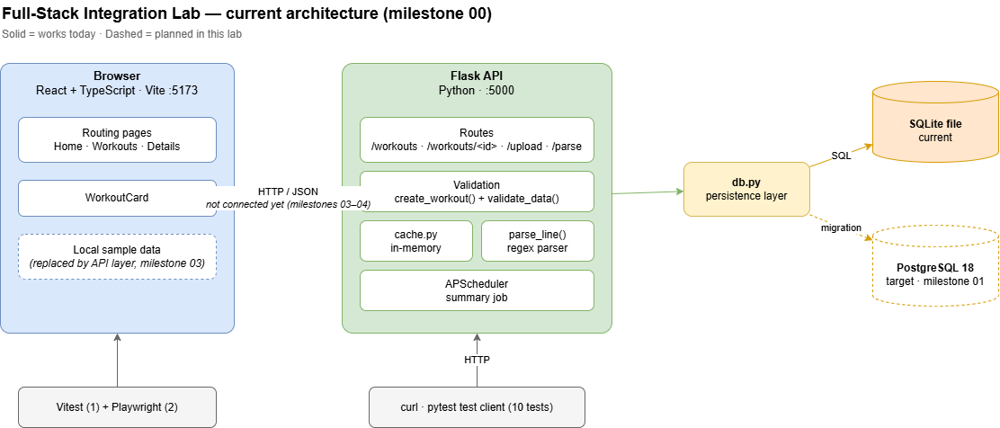

# 00 - Baseline

The starting point: a Flask API from the Python lab and a React app from the frontend lab, not yet connected.

## Decisions

- **One repository** for frontend and backend, so a change that touches both is one commit.
- **The workout domain again.** The API, validation, parser and tests already existed, so the work could go into connecting the parts.
- **Validation in three places, for different reasons:**
  - frontend: fast feedback in the form
  - API: the rule itself, for every way data comes in (form, curl, CSV, text)
  - database: a last check if a code path ever forgets to validate

## User journeys (the goals for the lab)

1. Browse workouts: filter by sport, page through the list, keep the filter in the URL.
2. Add a workout with a form that shows errors next to the field and keeps the input when saving fails.
3. Import a CSV file: preview first, nothing saved if any row is bad.
4. Type workouts as text, see how each line was understood, then save.
5. Always see what is happening: loading, empty, error with "Try again", success.

## What was reused

| Part | From | Status |
|---|---|---|
| `app.py`, `db.py`, `cache.py`, `parse_line()` | Python lab, concept 10 | Adapted later |
| Routing app, Playwright tests | Frontend lab, concept 12 | Adapted later |
| `WorkoutCard`, Vitest setup | Frontend lab, concept 11 | Card removed after milestone 11; setup kept |
| Fetch logic, form | Frontend lab, concepts 06 and 07 | Rebuilt in milestones 03 and 05 |

## Problems found at the start

- Different status codes and two error formats for similar requests.
- Invalid query parameters (`?limit=abc`) and non-numeric CSV values caused a `500`.
- `limit` had no upper bound.
- Text parsing saved immediately, without a preview.
- Tests wrote into the development database (about 200 extra rows).
- Frontend and API ran side by side but were not connected.

These were fixed in milestones 01, 03 and 08.

## Architecture at milestone 00

